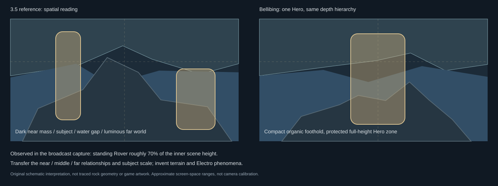

# Login-screen research and corrected Electro direction

**2026-10-29 · Draft PR #361 · owner visual review pending.** The owner rejected both coastal/meadow proposals. They are retained only as comparisons. Current work combines login-screen composition with the earlier Bellibing Electro identity; the percentages describe artistic responsibilities, not a pixel blend.

## Verified reference and variations

| Reference | Evidence used / boundary |
| --- | --- |
| Original launch framing | The [published launch capture](https://www.online-station.net/mobile-game/794813) shows two Rovers around a raised rock formation, with layered terrain behind. Its visible build is 1.0. It was visually inspected, but is insufficient as the latest visual reference. |
| 3.0 change | [Kuro's official 3.0 notes](https://wutheringwaves.kurogames.com/en/main/news/detail/3920) explicitly identify a Lahai-Roi-style login-screen and music change. This establishes a variation, not identical scenery across versions. |
| 3.5 change | The [3.5 special-program summary](https://www.invenglobal.com/articles/23197/wuthering-waves-35-special-program-kakaotalk-emoticons-tcg-and-more-announced) and [published version notes](https://news.17173.com/content/07112026/080809130.shtml) describe the Xuanfang/Mengzhou login update. |
| Actual 3.5 visual basis | The [special-program frame](https://img2-tc.tapimg.com/moment/etag/e6a0612225b09ed085513ca38107d381.jpg/_tap_ugc.jpg), published in this [broadcast summary](https://www.taptap.cn/moment/819690815566643802), was downloaded privately and visually inspected. The original is linked, not bundled. |

Public client captures and day/night recordings were located, but direct YouTube playback/thumbnails and Reddit media were inaccessible here. Their titles/comments are **not** treated as visual inspection. The verified visual basis is the actual 3.5 **special-program preview**, not a claim to have inspected today's live client, every intervening variation or both day/night states. Owner motion references were previously inspected through temporal frames; they do not establish their source rig/shader implementation.

## Composition analysis — completed before generation

In the 3.5 frame, a compact, dark raised rock mass occupies much of the lower scene and rises between the two subjects. The standing Rover occupies roughly 70% of the inner scene height. Water/atmospheric gaps separate this near mass from the banks and concentrated luminous far world. The background's directional brightness establishes distance behind the subjects. There is no ordinary beach-sunset horizon or broad grassy stage.

This explains the previous failure: the coastal experiments kept generic objects but changed their hierarchy. Their low flat foreground shelves, smaller subject envelope and open sunset sea gave the landscape priority and removed the stronger Electro material/lighting identity.

The [original schematic analysis](login-review/composition.svg) compares those observed relationships with a single-Hero adaptation. It interprets depth zones and subject scale; it does not trace exact rock geometry. A local annotated comparison using the actual broadcast image was rendered and inspected **before** artwork generation. That image remains outside the repository so no game-reference pixels enter the public delivery.

## One original Electro concept

The current proposal protects a full-height Hero area at source-image **x≈0.40–0.65, y≈0.13–0.87**, with a compact irregular mineral foothold, surrounding water/mist separation and a distant charged world. It adapts the two-Rover reference to one prominent Builder subject; it does not claim exact camera reconstruction or copied geometry.

The earlier [Bellibing Electro artwork](elemental-art/electro.webp) supplies elemental identity: charged mineral seams, ionized atmosphere, directed electrical lighting and reflected field phenomena. A first pass of this same composition overemphasized spires and glowing lines; its refinement removed floating structures, lowered distant forms and restored darker slate/water regions. This is one iterated composition, not several unrelated environments. No other element was regenerated.

The existing authentic upper-body Character image supplies actual color/subject reference inside the larger intended Hero area. Its lower-body region remains explicitly reserved. No legs, feet, physical art-to-ground contact or canonical Character pixels are fabricated. The full-height area and partial-art view help assess framing and visual weight, **not finished Character integration**. Approved full-body art or another rendering method remains a separate decision.

## Browser comparison and limits

The primary preview is **Electro Hero**. **Background / Hero area / Cards** retain one crop. Login composition study links the original reference and includes the original schematic. Rejected coastal/meadow studies and all six earlier elemental environments remain available under clearly marked comparison sections. Existing cards are retained; the identity caption moves above/right of the taller subject area to avoid covering its head.

The existing depth-aware renderer uses the new composition/map at the same small 0.55 pointer strength, with its additional perspective term disabled. This iteration adds no environmental animation; the previous water-light option is withheld for the new concept. Still, reduced motion and graphics failure preserve static artwork. Approximate depth maps cannot reconstruct unseen geometry or establish real Character lighting/contact. The foreground still reads relatively broad; its proportion and the intended full-body silhouette require owner visual judgment against the reference. Passing browser checks does not establish artistic acceptance.

Actual [browser results](login-review/review.json), [Inventory regression](login-review/inventory-review.json), [retained-element compatibility](login-review/legacy-review.json) and [source/artifact identities](login-review/identity.json) identify the reviewed delivery. Screenshots: [background](login-review/background-1440.jpg), [Hero area with partial original art](login-review/hero-area-1440.jpg), [functional cards](login-review/cards-1440.jpg), [depth motion](login-review/depth-motion-1440.jpg).

All work remains isolated under this concept directory. No production gameplay, persistence, canonical data or private computation changes. Keep Draft; no merge/deployment. **Stop for owner review of this single Electro concept before expanding.**
