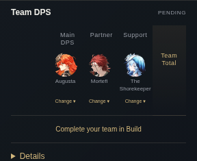
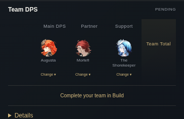
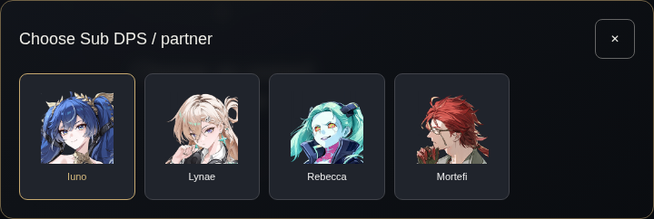
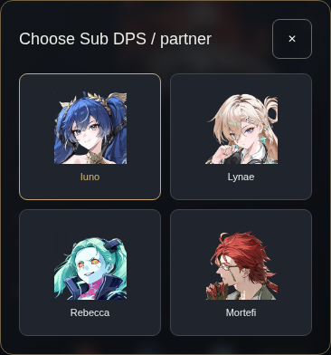

# Member-driven Team DPS visual review

Actual Chromium screenshots, 1440×900 desktop and 390×844 mobile. Before is public #344; after is this member-only UX candidate. Both use a clean, unowned account: no invented DPS or private artifacts. Before shows Augusta/Iuno/Shorekeeper; after explicitly picks Mortefi and retains Shorekeeper. The private-engine numeric and advisor screenshots remain private local review evidence.

| Route / viewport | Before | After |
| --- | --- | --- |
| Improve desktop | [Before](before-improve-1440.png) | [After](after-improve-1440.png) |
| Sandbox desktop | [Before](before-sandbox-1440.png) | [After](after-sandbox-1440.png) |
| Improve mobile | [Before](before-improve-390.png) | [After](after-improve-390.png) |
| Sandbox mobile | [Before](before-sandbox-390.png) | [After](after-sandbox-390.png) |

## Compact comparison

## Candidate portraits

Full-page and panel images were inspected visually, including mobile name/role alignment, empty-build action and source details. UI Lab also uploads fresh team-selection screenshots for its exact head; green tests are not product-owner visual approval. No merge/deployment/publication is implied.
